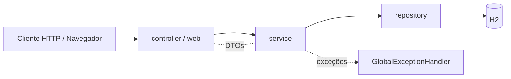
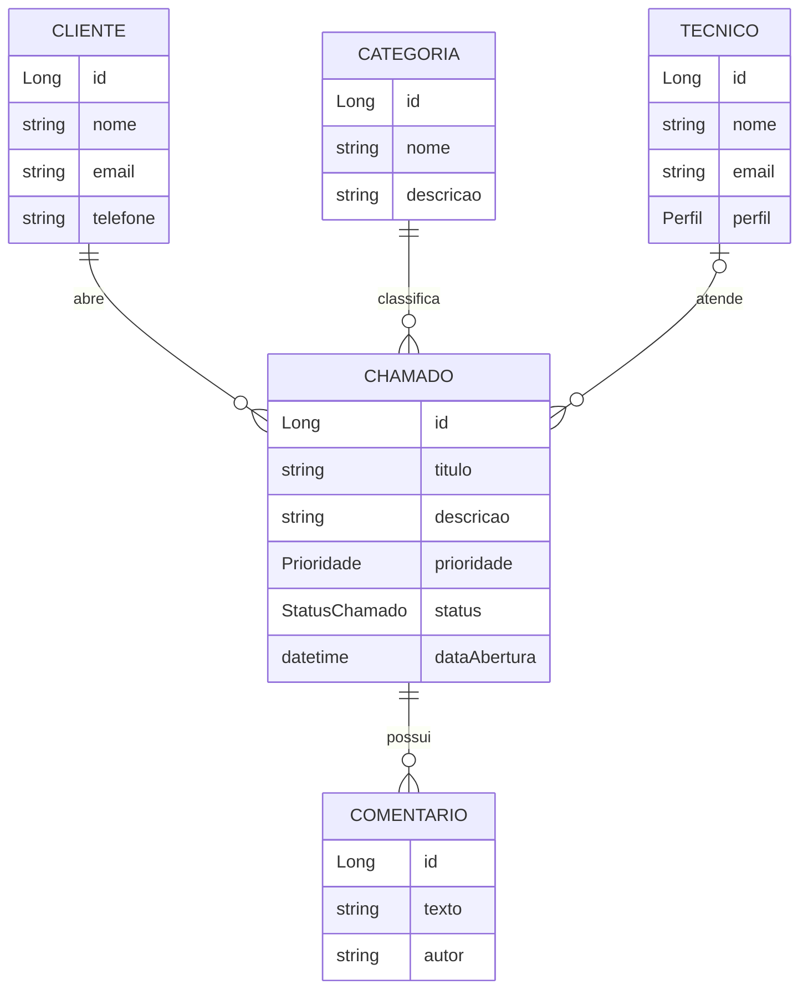

<div align="center">

# 🛠️ Sistema de Gerenciamento de Chamados

**API REST + Interface Web para abertura, acompanhamento e atendimento de chamados de suporte.**


🇧🇷 Português · [🇬🇧 English](#-english-version)

</div>

---

## 📑 Sumário

- [Sobre o projeto](#-sobre-o-projeto)
- [Funcionalidades](#-funcionalidades)
- [Tecnologias](#-tecnologias)
- [Arquitetura](#-arquitetura)
- [Modelo de domínio](#-modelo-de-domínio)
- [Regras de negócio](#-regras-de-negócio)
- [Como executar](#-como-executar)
- [Interface web](#-interface-web)
- [Documentação da API](#-documentação-da-api-swagger)
- [Endpoints](#-endpoints)
- [Guia prático de testes](#-guia-prático-de-testes-postman)
- [Testes automatizados](#-testes-automatizados)
- [Autor](#-autor)

---

## 💻 Sobre o projeto

Aplicação desenvolvida em **Java com Spring Boot** para gerenciar **chamados de suporte**: clientes abrem chamados, classificados por **categoria** e **prioridade**, que são atribuídos a **técnicos** e acompanhados por meio de **comentários** até o fechamento.

O projeto expõe **duas formas de uso** sobre o mesmo núcleo de regras de negócio:

- 🔌 uma **API RESTful** documentada com Swagger/OpenAPI;
- 🖥️ uma **interface web** (Thymeleaf) com dashboard e telas de CRUD.

Foi construído com foco em boas práticas de Engenharia de Software: separação de responsabilidades em camadas, DTOs, validação de entrada, tratamento global de erros e uma suíte de testes automatizados.

## ✨ Funcionalidades

- ✅ CRUD completo de **Clientes**, **Categorias** e **Técnicos**
- ✅ Abertura de **chamados** com título, descrição, prioridade, cliente e categoria
- ✅ **Atribuição de técnico** (o chamado passa automaticamente para `EM_ATENDIMENTO`)
- ✅ **Mudança de status** ao longo do ciclo de vida do chamado
- ✅ **Comentários** em cada chamado, formando um histórico de atendimento
- ✅ **Listagem paginada** com filtros por status, prioridade e cliente
- ✅ **Dashboard** web com visão geral dos chamados
- ✅ **Respostas de erro padronizadas** (400, 404 e 409)
- ✅ **Dados de demonstração** carregados automaticamente na inicialização
- ✅ **Swagger UI** e **console do H2** habilitados

## 🚀 Tecnologias

| Camada | Tecnologia |
|---|---|
| Linguagem | Java 21 |
| Framework | Spring Boot 4.1.1 (Web MVC, Data JPA, Validation) |
| Interface web | Thymeleaf + CSS próprio |
| Banco de dados | H2 (em memória) |
| Documentação | springdoc-openapi 2.8.4 (Swagger UI) |
| Testes | JUnit 5, Mockito, Spring Test (`@WebMvcTest`, `@DataJpaTest`) |
| Build | Maven (Maven Wrapper incluso) |

## 🧱 Arquitetura

O código segue uma arquitetura em camadas, em `br.com.sistemas.chamados`:

```
src/main/java/br/com/sistemas/chamados
├── controller/   → Controllers REST (JSON)
├── web/          → Controllers MVC da interface web (Thymeleaf)
├── service/      → Regras de negócio
├── repository/   → Acesso a dados (Spring Data JPA)
├── entity/       → Entidades JPA e enums
├── dto/          → Objetos de requisição/resposta (records)
├── exception/    → Exceções de negócio e handler global
└── config/       → Carga de dados de demonstração

src/main/resources
├── templates/    → Páginas Thymeleaf (dashboard, chamados, clientes, ...)
├── static/css/   → Estilos
└── application.properties
```



## 🗂️ Modelo de domínio



**Enums**

| Enum | Valores |
|---|---|
| `StatusChamado` | `ABERTO`, `EM_ATENDIMENTO`, `AGUARDANDO_CLIENTE`, `FECHADO` |
| `Prioridade` | `BAIXA`, `MEDIA`, `ALTA`, `CRITICA` |
| `Perfil` | `ADMIN`, `TECNICO` |

## 📏 Regras de negócio

| Regra | Resultado |
|---|---|
| E-mail de cliente ou técnico já cadastrado | `409 Conflict` |
| Nome de categoria já cadastrado | `409 Conflict` |
| Excluir cliente, categoria ou técnico que possui chamados vinculados | `409 Conflict` |
| Atribuir técnico, alterar status ou comentar em chamado **fechado** | `409 Conflict` |
| Atribuir técnico a um chamado `ABERTO` | status muda para `EM_ATENDIMENTO` |
| Dados inválidos (campo obrigatório, e-mail malformado, tamanho excedido) | `400 Bad Request` com lista de detalhes |
| Recurso inexistente | `404 Not Found` |

## 🚦 Como executar

**Pré-requisito:** [JDK 21](https://adoptium.net/) ou superior. O Maven não precisa estar instalado (o projeto inclui o Maven Wrapper).

```bash
# 1. Clone o repositório
git clone https://github.com/mateustavaressantos/chamados.git
cd chamados

# 2. Execute a aplicação
./mvnw spring-boot:run        # Linux / macOS
.\mvnw spring-boot:run        # Windows (PowerShell / CMD)
```

Depois de iniciar, acesse:

| Recurso | URL |
|---|---|
| 🖥️ Interface web (dashboard) | http://localhost:8080/ |
| 📘 Swagger UI | http://localhost:8080/swagger-ui.html |
| 🗄️ Console do H2 | http://localhost:8080/h2-console |

> **Console do H2:** JDBC URL `jdbc:h2:mem:chamadosdb`, usuário `sa`, senha em branco.

> ℹ️ O banco é **em memória**: os dados são recriados a cada execução. Ao iniciar, a aplicação carrega automaticamente dados de demonstração, para que você já encontre conteúdo nas telas:
>
> | Entidade | Quantidade | Exemplos |
> |---|---|---|
> | Categorias | 13 | Hardware, Redes, Software, Banco de Dados, Impressoras, E-mail, Segurança, Backup… |
> | Clientes | 7 | Empresa Para-Chamados, Loja de Jogos, Clínica Vida Saudável, Tech Solutions Ltda… |
> | Técnicos | 4 | Mateus Tavares (`ADMIN`), Valeska Ingrid, Carlos Eduardo, Ana Beatriz (`ADMIN`) |
> | Chamados | 12 | Distribuídos entre todos os status e prioridades (inclusive `FECHADO` e `CRITICA`) |
> | Comentários | 6 | Histórico de atendimento em chamados em andamento e fechados |

## 🖥️ Interface web

Disponível em `http://localhost:8080/`, com navegação entre as telas:

| Tela | Rota | O que faz |
|---|---|---|
| Dashboard | `/` | Visão geral dos chamados |
| Chamados | `/web/chamados` | Lista, abre novo chamado, vê detalhes, comenta, atribui técnico e altera status |
| Clientes | `/web/clientes` | Cadastro, edição, exclusão e chamados do cliente |
| Categorias | `/web/categorias` | Cadastro, edição e exclusão |
| Técnicos | `/web/tecnicos` | Cadastro, edição e exclusão |

## 📘 Documentação da API (Swagger)

Com a aplicação rodando, a documentação interativa fica em
**http://localhost:8080/swagger-ui.html** (especificação OpenAPI em `/v3/api-docs`). Nela é possível ler e **testar todos os endpoints** direto pelo navegador.

## 🔗 Endpoints

### Clientes — `/clientes`
| Método | Rota | Descrição |
|---|---|---|
| `POST` | `/clientes` | Cria cliente |
| `GET` | `/clientes` | Lista clientes |
| `GET` | `/clientes/{id}` | Busca cliente por ID |
| `PUT` | `/clientes/{id}` | Atualiza cliente |
| `DELETE` | `/clientes/{id}` | Exclui cliente |
| `GET` | `/clientes/{id}/chamados` | Lista chamados do cliente |

### Categorias — `/categorias`
| Método | Rota | Descrição |
|---|---|---|
| `POST` | `/categorias` | Cria categoria |
| `GET` | `/categorias` | Lista categorias |
| `GET` | `/categorias/{id}` | Busca categoria por ID |
| `PUT` | `/categorias/{id}` | Atualiza categoria |
| `DELETE` | `/categorias/{id}` | Exclui categoria |

### Técnicos — `/tecnicos`
| Método | Rota | Descrição |
|---|---|---|
| `POST` | `/tecnicos` | Cria técnico |
| `GET` | `/tecnicos` | Lista técnicos |
| `GET` | `/tecnicos/{id}` | Busca técnico por ID |
| `PUT` | `/tecnicos/{id}` | Atualiza técnico |
| `DELETE` | `/tecnicos/{id}` | Exclui técnico |

### Chamados — `/chamados`
| Método | Rota | Descrição |
|---|---|---|
| `POST` | `/chamados` | Abre chamado |
| `GET` | `/chamados` | Lista com paginação e filtros (`status`, `prioridade`, `clienteId`, `page`, `size`) |
| `GET` | `/chamados/{id}` | Detalhe do chamado |
| `PATCH` | `/chamados/{id}/atribuir` | Atribui técnico |
| `PATCH` | `/chamados/{id}/status` | Altera status |

### Comentários — `/chamados/{chamadoId}/comentarios`
| Método | Rota | Descrição |
|---|---|---|
| `POST` | `/chamados/{id}/comentarios` | Adiciona comentário |
| `GET` | `/chamados/{id}/comentarios` | Lista histórico de comentários |

## 🧪 Guia prático de testes (Postman)

Os dados de demonstração já existem ao iniciar, mas você pode criar os seus. Siga o roteiro (com os dados de demonstração, os registros que você criar receberão IDs sequenciais após os existentes, como 8 para cliente e 14 para categoria; ajuste os IDs nos exemplos conforme necessário. Para testar sem criar nada, use os IDs já existentes, como `clienteId: 1` e `categoriaId: 1`).

<details>
<summary><b>1. Setup inicial</b></summary>

**Criar cliente** — `POST /clientes`
```json
{
  "nome": "Mateus Tavares dos Santos",
  "email": "mateus@gmail.com",
  "telefone": "47999999999"
}
```

**Criar categoria** — `POST /categorias`
```json
{
  "nome": "Atualização de conta",
  "descricao": "Atualizar informações sobre a conta do usuário/cliente"
}
```

**Criar técnico** — `POST /tecnicos`
```json
{
  "nome": "Emilly",
  "email": "emilly@gmail.com",
  "perfil": "TECNICO"
}
```
</details>

<details>
<summary><b>2. Ciclo de vida do chamado</b></summary>

**Abrir chamado** — `POST /chamados`
```json
{
  "titulo": "Mudei de nome",
  "descricao": "Alterei meu nome e preciso atualizar o nome da minha conta",
  "prioridade": "ALTA",
  "clienteId": 1,
  "categoriaId": 1
}
```

**Adicionar comentário** — `POST /chamados/1/comentarios`
```json
{
  "texto": "Solicitação recebida, iniciando análise.",
  "autor": "Sistema"
}
```

**Atribuir técnico** — `PATCH /chamados/1/atribuir`
```json
{ "tecnicoId": 1 }
```

**Fechar chamado** — `PATCH /chamados/1/status`
```json
{ "status": "FECHADO" }
```

> 💡 **Dica:** depois de fechar o chamado, tente comentar, atribuir técnico ou mudar o status. A API responderá `409 Conflict` com a mensagem da regra de negócio.
</details>

<details>
<summary><b>3. Consultas, filtros e paginação</b></summary>

| Objetivo | Requisição |
|---|---|
| Paginação simples | `GET /chamados?size=2` |
| Página específica | `GET /chamados?size=2&page=0` |
| Filtrar por status | `GET /chamados?status=EM_ATENDIMENTO` |
| Status + prioridade | `GET /chamados?status=EM_ATENDIMENTO&prioridade=ALTA` |
| Chamados de um cliente | `GET /clientes/1/chamados` |
| Detalhe de um chamado | `GET /chamados/1` |
| Comentários de um chamado | `GET /chamados/1/comentarios` |
</details>

<details>
<summary><b>4. Formato de erro</b></summary>

Exemplo de `400 Bad Request` ao enviar um e-mail inválido:

```json
{
  "momento": "2026-11-09T10:15:30.123",
  "status": 400,
  "erro": "Dados inválidos",
  "detalhes": ["Email inválido"]
}
```
</details>

## 🛡️ Testes automatizados

A suíte cobre as diferentes camadas da aplicação:

| Camada | Abordagem | O que valida |
|---|---|---|
| **Controller** | `@WebMvcTest` + `@MockitoBean` | Endpoints REST e códigos HTTP (201, 400, 404, 409) |
| **Repository** | `@DataJpaTest` (H2) | Consultas personalizadas e persistência |
| **Service** | JUnit 5 + Mockito | Regras de negócio (e-mails duplicados, chamado fechado, etc.) |
| **Web** | Testes de páginas | Renderização das telas Thymeleaf |

Para executar todos os testes:

```bash
./mvnw test        # Linux / macOS
.\mvnw test        # Windows
```

## 👤 Autor

**Mateus Tavares dos Santos** — projeto acadêmico da disciplina de *Design e Arquitetura de Software* (Univille, 6º semestre).

---

<a id="-english-version"></a>

## 🇬🇧 English Version

### About

A **Java / Spring Boot** application for managing **support tickets**. Clients open tickets classified by **category** and **priority**; tickets are assigned to **technicians** and tracked through **comments** until closed. It offers both a **RESTful API** (documented with Swagger/OpenAPI) and a **Thymeleaf web interface** with a dashboard and CRUD screens.

### Features

- Full CRUD for Clients, Categories and Technicians
- Ticket creation, technician assignment and status changes
- Per-ticket comment history
- Paginated listing with filters (status, priority, client)
- Standardized error responses (400, 404, 409)
- Demo data loaded on startup (13 categories, 7 clients, 4 technicians, 12 tickets, 6 comments)

### Tech stack

Java 21 · Spring Boot 4.1.1 (Web MVC, Data JPA, Validation) · Thymeleaf · H2 (in-memory) · springdoc-openapi (Swagger UI) · JUnit 5 + Mockito · Maven

### Business rules

- Duplicate client/technician e-mail or category name → `409 Conflict`
- Deleting a client, category or technician linked to tickets → `409 Conflict`
- Assigning, changing status or commenting on a **closed** ticket → `409 Conflict`
- Assigning a technician to an `OPEN` ticket moves it to `EM_ATENDIMENTO` (in progress)
- Invalid payload → `400 Bad Request`; unknown resource → `404 Not Found`

### Running

Requires **JDK 21+**. Maven is bundled via the wrapper.

```bash
git clone https://github.com/mateustavaressantos/chamados.git
cd chamados
./mvnw spring-boot:run     # Windows: .\mvnw spring-boot:run
```

| Resource | URL |
|---|---|
| Web UI | http://localhost:8080/ |
| Swagger UI | http://localhost:8080/swagger-ui.html |
| H2 Console | http://localhost:8080/h2-console (`jdbc:h2:mem:chamadosdb`, user `sa`, empty password) |

Data lives in memory and is recreated on every start.

### Tests

```bash
./mvnw test
```

Covers controllers (`@WebMvcTest`), repositories (`@DataJpaTest`), services (Mockito) and web pages. The endpoint list and Postman examples above apply as-is (JSON field names are in Portuguese).

### Author

**Mateus Tavares dos Santos** — academic project for *Software Design and Architecture* (Univille, 6th semester).
